<div dir="rtl" align="center">

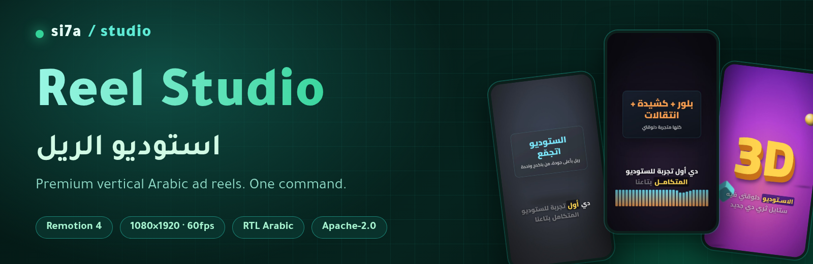

<br>

<a href="https://github.com/abdelmaseh/reel-studio-ar"></a> <a href="https://t.me/abdelmasehrefaat"></a> <a href="https://instagram.com/si7a_ref3t_">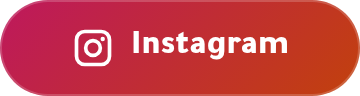</a>

<br><br>

**استوديو متكامل لإنتاج ريلز إعلانية عربية بجودة بريميوم، بأمر واحد.**
<br>
*A complete, batteries-included pipeline for premium vertical Arabic ad reels.*

`1080x1920` · `60fps delivery` · `H.264 + AAC` · `WhatsApp-ready under 14 MB` · `Remotion 4`

</div>

---

<div dir="rtl">

## ✨ المميزات | Capabilities

</div>

<div align="center">

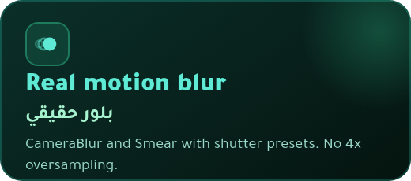
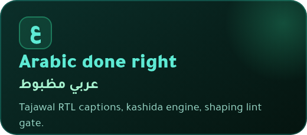
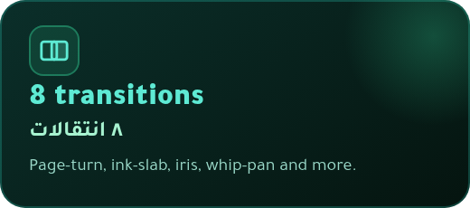
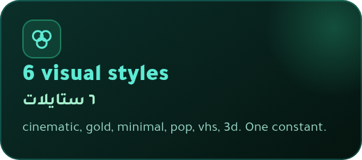
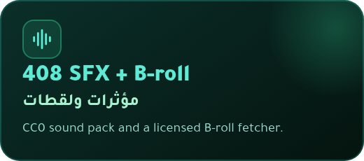
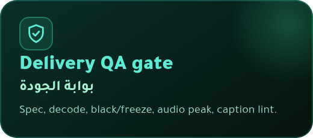

</div>

<div dir="ltr">

| | الميزة / Feature | التفاصيل / Details |
|:-:|---|---|
| 🎥 | **Real motion blur** | `@remotion/motion-blur` (`CameraBlur`, `Smear`) with shutter presets. No more render-at-4x-fps oversampling. A documented 50fps × 4-subframe fallback stays in the runbook. |
| 🔤 | **Arabic done right** | Tajawal per-word RTL captions driven by Whisper word timings, with a real kashida (tatweel) engine that only stretches legal joining slots, plus a lint gate that blocks delivery on broken shaping (split joins, presentation forms, tatweel at word edges, ZWJ inside words). |
| 🎞️ | **8 curated transitions** | Ported from reel-studio's transitions-v4: page-turn (Arabic-book direction), ink-slab, lens-zoom, iris, dot-zoom, zoom-through, blinds, plus whip-pan with built-in speed-based blur and a light-scan sheen. |
| 🎨 | **6 named visual styles** | `cinematic`, `gold`, `minimal`, `pop`, `vhs`, `3d`. Each sets palette, caption treatment, default transition, grain/vignette and SFX flavor. Switch a whole reel with one constant. The `3d` style keeps pop energy with real depth: perspective, parallax layers, contact shadows, DOF blur, extruded text (see RUNBOOK section 3D and `Demo3D`). |
| 🧭 | **108-move catalog** | Energy/family/cue metadata and a planner discipline (3 core moves + accents per video), adapted from video-ad-editor. |
| 🔊 | **408-sound CC0 SFX pack** | With a searchable catalog. |
| 📹 | **B-roll fetcher** | `broll-fetch.mjs` searches and downloads free stock clips (Coverr keyless by default; Mixkit; Pexels/Pixabay with free API keys) and writes a license manifest per clip. |
| 📈 | **Audio-reactive graphics** | Band/energy/ducking/onset analysis hooks (`audioviz.ts`). |
| ✅ | **Delivery QA gate** | Container spec, full decode, black/freeze-frame detection, audio peak level, and the Arabic caption lint. The gate fails, the reel doesn't ship. |

</div>


---

<div dir="rtl">

## 🆕 التحديث الجديد | What's new: Montage toolkit, 3D B-roll, subject isolation, style pack

</div>

<div align="center">

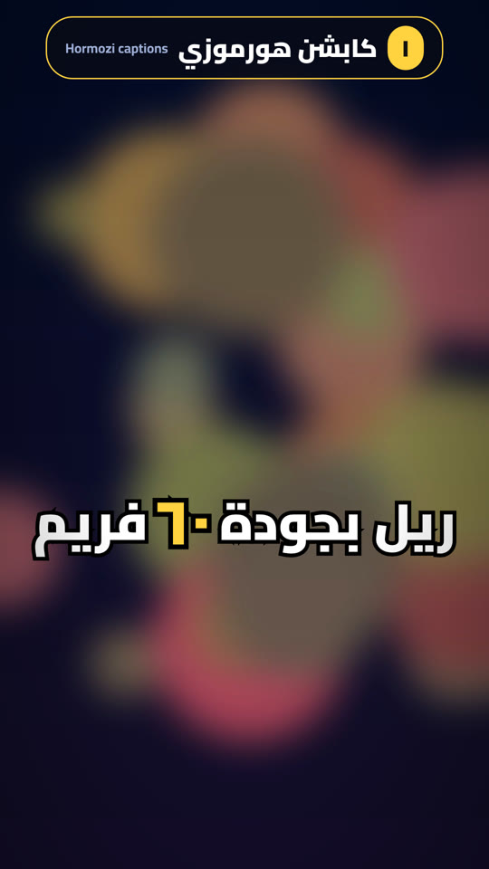 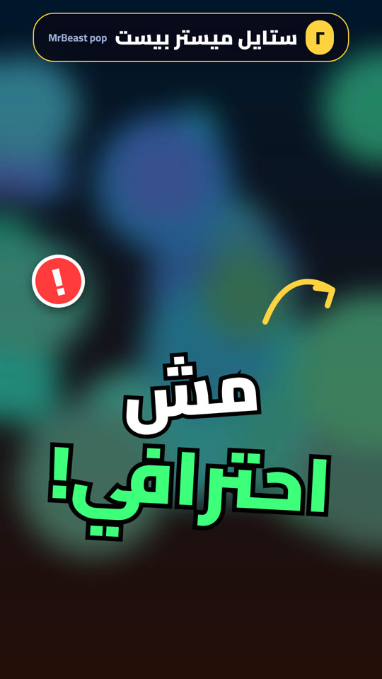 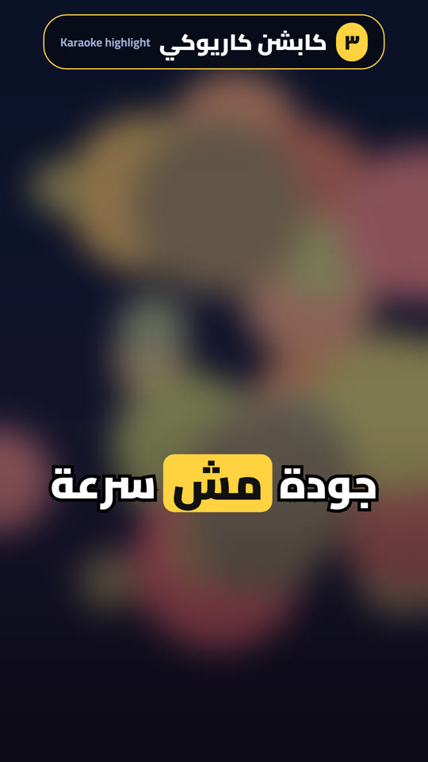 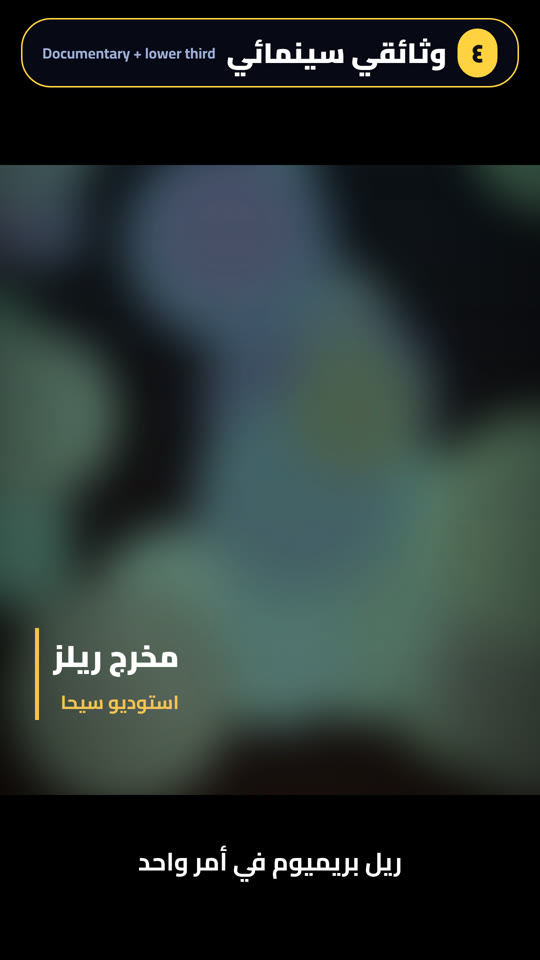 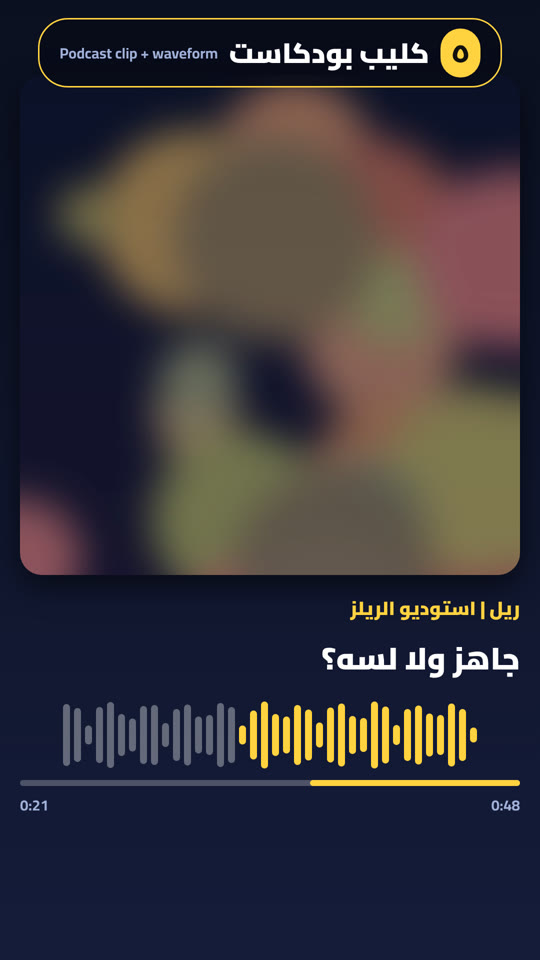 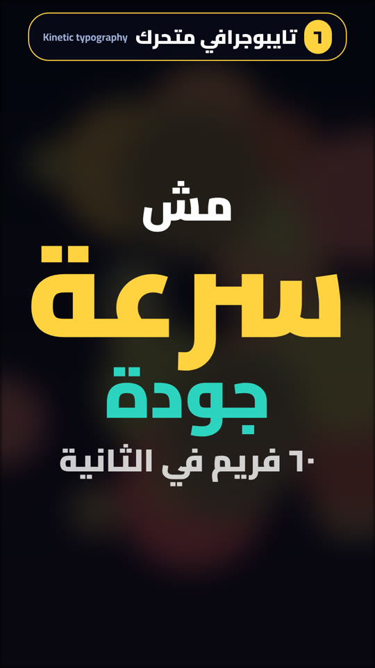 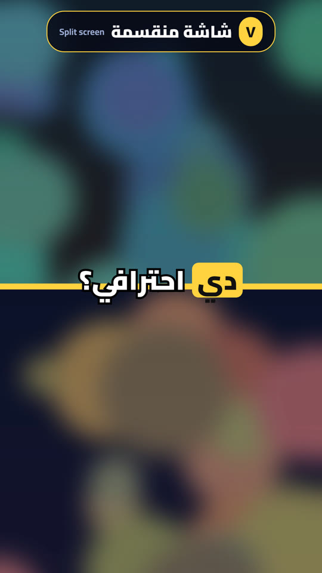 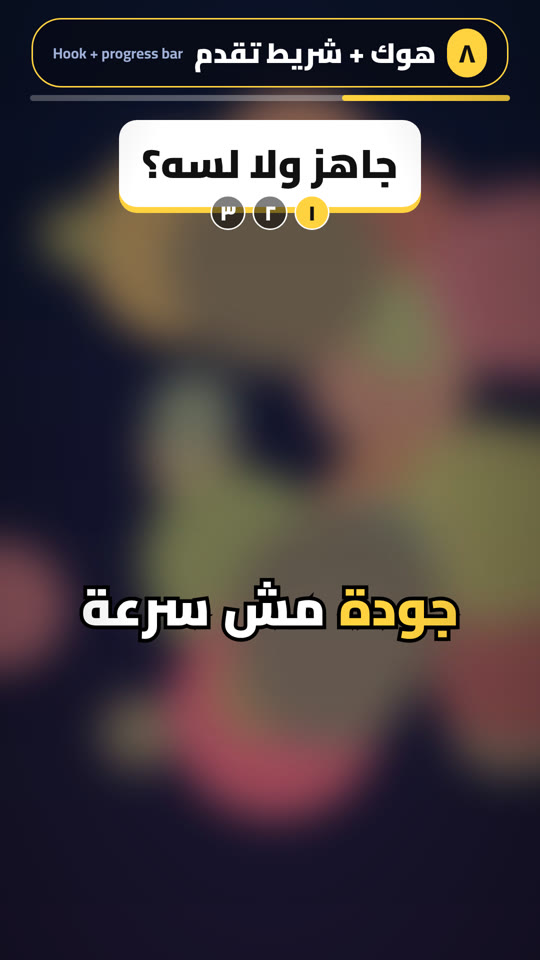 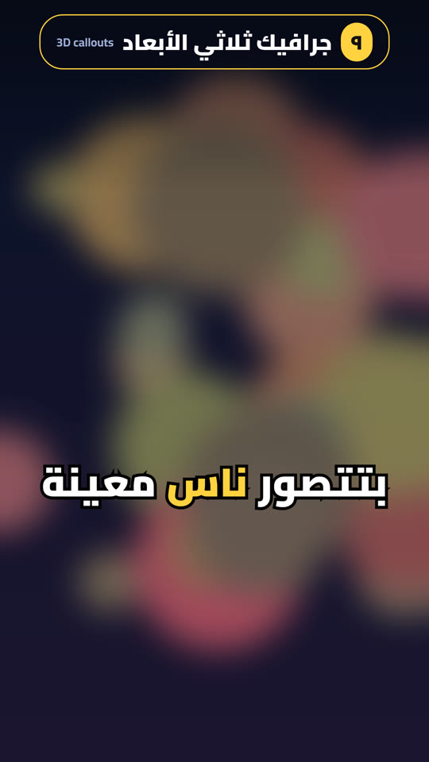 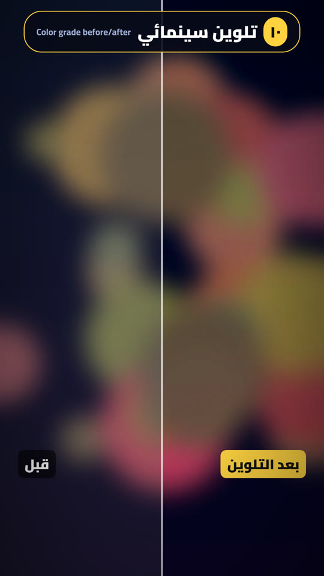 

</div>

| Feature | What it does | Where |
|---|---|---|
| **Montage toolkit** | beat detection, silence cut points, cut snapping, beat-synced EDL planner, pacing QA lint | `template/src/montage/` |
| **3D B-roll (Broll3D)** | CSS-3D headline/number/chip callouts in the top band, never over the face | `template/src/broll3d/` |
| **Punch captions (Hormozi style)** | 1-3 words, Cairo 900, thick outline, one accent word, word-level timing | `template/src/captions/PunchCaptions.tsx` |
| **Subject isolation / text behind subject** | person cutout PNG sequence + 3D text between room and person via the `behind` clip field | `scripts/subject_matte.py`, `Montage.tsx` |
| **Style pack** | 10 style looks (`StyleFrame` composition, id 1..10): Hormozi, MrBeast, karaoke, documentary, podcast clip, kinetic typography, split screen (on request), hook + progress bar, 3D callouts, cinematic grade | `template/src/styleboard/`, `docs/STYLES.md` |
| **Progress bar, varied punch-ins, SFX placement** | retention elements from the pro talking-head style guide | `Montage.tsx`, `docs/STYLES.md` |

Notes: the style images above are in-studio renders of each look on a generated background (our own material, no third-party footage; not screenshots of real creators). External reference sources for each style are listed in `docs/STYLES.md`. Delivery is 30fps for the 3D-heavy montage composition.

---

<div dir="rtl">

## 🖼️ معاينة من الريندر | Real render previews

</div>

<div dir="ltr">

*Frames rendered straight from this repo's `Demo` and `Demo3D` compositions.*

</div>

<div align="center">

| Title card | Captions + kashida | 3D hook | 3D title |
|:-:|:-:|:-:|:-:|
| 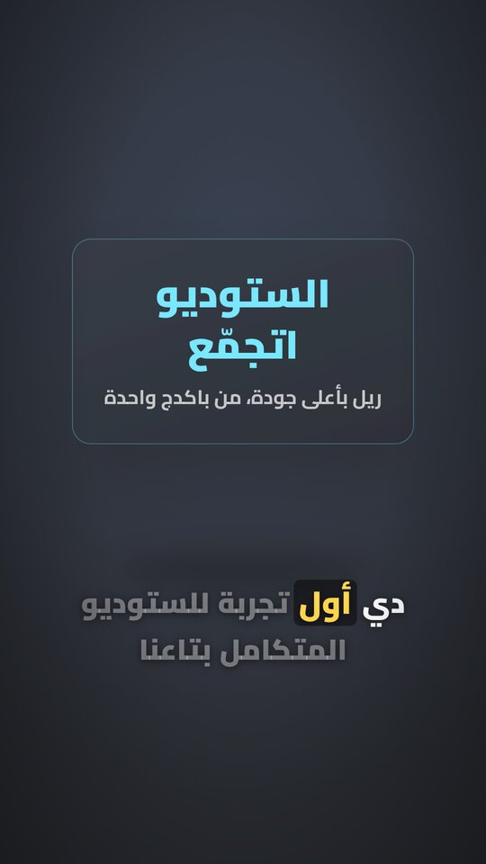 | 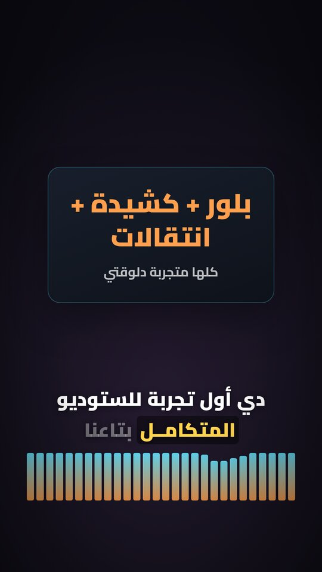 | 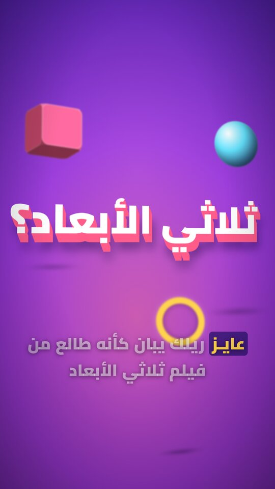 | 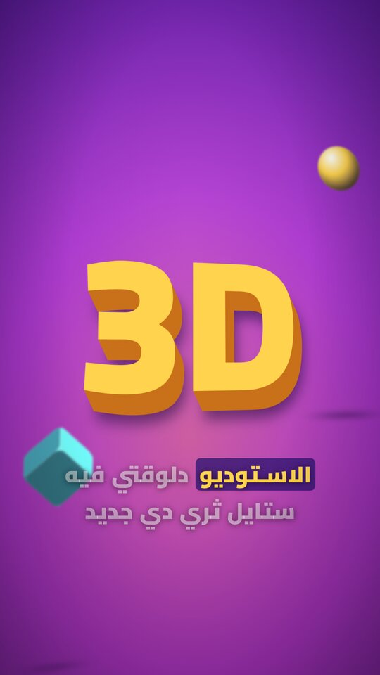 |

</div>

---

<div dir="rtl">

## 🎨 معرض الستايلات | Style gallery

</div>

<div align="center">

| `cinematic` | `gold` | `minimal` | `pop` | `vhs` | `3d` |
|:-:|:-:|:-:|:-:|:-:|:-:|
| 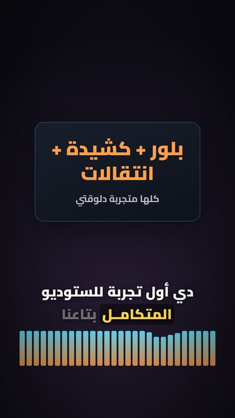 | 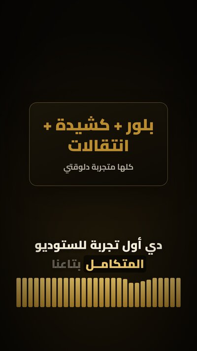 | 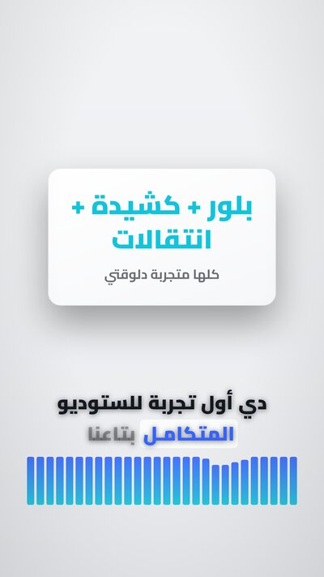 | 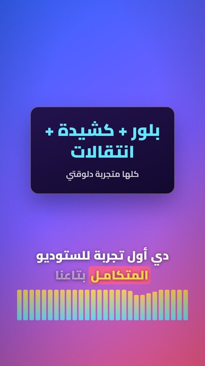 | 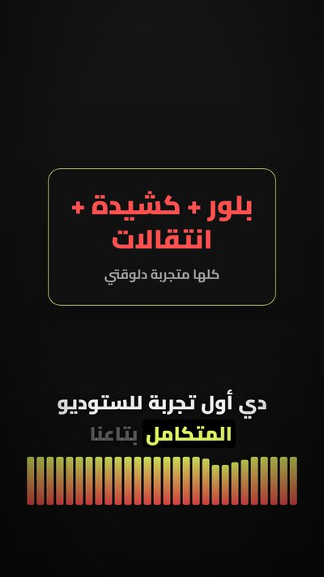 | 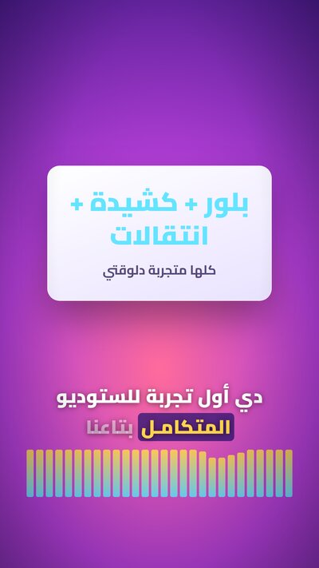 |
| dark teal, default | luxury gold | clean light | loud pop | gritty VHS | real depth |

</div>

<div dir="ltr">

Set it once in `template/src/styles.ts` (`ACTIVE_STYLE`) or per composition via `defaultProps: {styleName: 'gold'}`.

</div>

---

<div dir="rtl">

## 🚀 التثبيت السريع | Quickstart

</div>

<div dir="ltr">

**Requirements:** Node.js 22.18+ (24 LTS is fine; the QA gate runs TypeScript natively), Git, curl. On Windows use **Git Bash**
(`winget install OpenJS.NodeJS.LTS` and `winget install Git.Git`). `INSTALL.sh` checks them first and
tells you exactly what is missing. **ffmpeg/ffprobe are installed automatically** into `tools/ffmpeg/bin`
inside the repo if they are not already on your PATH (no admin rights, no PATH edits;
`render-reel.sh` and `qa-gate.mjs` use that local copy first). macOS: `brew install ffmpeg`.

</div>

<div dir="ltr">

```bash
./INSTALL.sh                      # one-command setup (node modules, fonts, SFX, vendor copy)
cd template
npx remotion still src/index.ts Demo preview.png --frame=45   # smoke test
bash scripts/render-reel.sh Demo 250 out.mp4        # silent demo; add --voiceover vo.mp3 / --mix mix.txt for audio
node scripts/qa-gate.mjs out.mp4
```

</div>

<div dir="ltr">

Delivery container is **60fps by default**; pass `--fps` to override.
Then read **[RUNBOOK.md](RUNBOOK.md)**, the full production manual (Egyptian Arabic + English):
shot list discipline, physics rules, caption gate, B-roll workflow, QA, compression.

</div>

---

<div dir="rtl">

## ❓ أسئلة شائعة | FAQ

</div>

<div dir="ltr">

<details>
<summary><b>إيه المطلوب عشان أشغّله؟ | What do I need installed?</b></summary>

<br>

Node.js 22.18+, Git and curl. `INSTALL.sh` checks all three and prints the exact fix for anything missing. ffmpeg and ffprobe are downloaded locally into `tools/ffmpeg/bin` if you don't have them (on macOS use `brew install ffmpeg`).

</details>

<details>
<summary><b>أغيّر الستايل إزاي؟ | How do I switch the style?</b></summary>

<br>

Change `ACTIVE_STYLE` in `template/src/styles.ts`, or set `defaultProps: {styleName: 'gold'}` on a single composition. Palette, captions, transition, grain and SFX flavor all follow.

</details>

<details>
<summary><b>الفيديو ما عدّاش بوابة الجودة؟ | The QA gate failed, what now?</b></summary>

<br>

That is by design. `node scripts/qa-gate.mjs out.mp4` reports which check failed (container spec, decode, black/freeze frames, audio peak or Arabic caption lint). Fix it and render again. The RUNBOOK covers each case.

</details>

<details>
<summary><b>اللقطات والمؤثرات مرخصة؟ | Are the B-roll clips and SFX licensed?</b></summary>

<br>

The SFX pack is CC0. `broll-fetch.mjs` writes a license manifest next to every downloaded clip so you can check terms before shipping.

</details>

<details>
<summary><b>الكابشن العربي بيتكسر؟ | Will Arabic captions break?</b></summary>

<br>

The kashida engine only stretches legal joining slots, and the lint gate blocks delivery on split joins, presentation forms, tatweel at word edges and ZWJ inside words.

</details>

</div>

---

<div dir="rtl">

## 📁 هيكل المشروع | Layout

</div>

<div dir="ltr">

```
INSTALL.sh            one-command setup, safe to re-run
RUNBOOK.md            production manual (AR + EN)
README.md             this file
LICENSE / ATTRIBUTION.md / LICENSES/
docs/                 README images (banner, buttons, cards, render previews)
vendor/               ported modules with their license headers (see ATTRIBUTION.md)
template/             the Remotion project (src/, scripts/, public/)
assets/sfx/           CC0 sound pack (cloned by INSTALL.sh)
```

</div>

---

<div align="center">

## 👤 عن المؤلف | About si7a

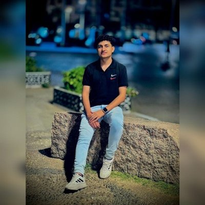

**Siha Refaat (si7a)**, builder of Reel Studio.
بعمل أدوات بتحوّل كلمة واحدة لريل عربي سينمائي كامل.
*I make tools that turn a single word into a finished, cinematic Arabic reel.*

<a href="https://t.me/abdelmasehrefaat"></a> <a href="https://instagram.com/si7a_ref3t_"></a>

Telegram: [t.me/abdelmasehrefaat](https://t.me/abdelmasehrefaat) · Instagram: [@si7a_ref3t_](https://instagram.com/si7a_ref3t_)

لو عندك فكرة أو سؤال أو جربت الاستوديو، كلمني على أي حساب فيهم.

</div>

---

## Credits

Built on the shoulders of three open projects. See [ATTRIBUTION.md](ATTRIBUTION.md) for the full notices:
[mohamedabdou-ai/reel-studio](https://github.com/mohamedabdou-ai/reel-studio) (Apache-2.0; the ported transitions come from its transitions-v4),
[majedphotos/video-ad-editor](https://github.com/majedphotos/video-ad-editor) (MIT),
[Reodelbasalan/adbertiser-sfx](https://github.com/Reodelbasalan/adbertiser-sfx) (CC0),
plus the cinematic-motion craft references. Tajawal font (OFL). Remotion (remotion.dev).
Images in `docs/img/` are original to this repo and were rendered from it.
